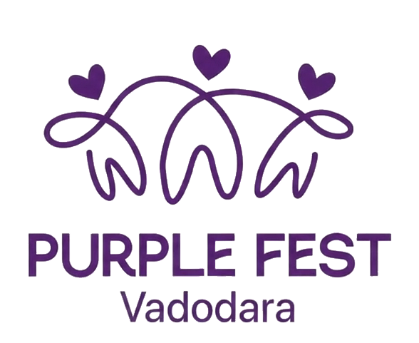

# Purple Fest Vadodara 2027

Official web experience for **Purple Fest Vadodara 2027** — India's premier festival celebrating diversity, inclusivity, accessibility, and empowerment.



---

## Highlights & Features

- **Cinematic Flow Animation Intro**: Stroke-by-stroke flowing line drawing animation representing unity and inclusivity, featuring the authentic 3-heart emblem.
- **Accessibility First**:
  - Live Text-to-Speech (TTS) reading assistant.
  - Multi-mode high-contrast and dyspraxia/reading friendly font toggles.
  - Screen reader semantic markup (`aria-*` labels, landmarks, live regions).
  - Keyboard navigable with focus rings.
- **Interactive Schedule & Event Hub**:
  - Filter by day, zone (Sports, Tech Expo, Cultural, Workshops).
  - Save sessions to personal itinerary with offline local storage sync.
- **Interactive Festival Zone Map**:
  - Visual layout of Navlakhi Grounds with detailed zone coordinates.
- **Dynamic Registration & Ticket Pass Generator**:
  - Instant digital delegate pass with unique QR code verification.
  - Printable and downloadable passes.
- **Live Assistant Chatbot (Mitra)**:
  - Instant help with venue directions, accessible transport, and event schedules.

---

## Quick Start (Local Setup)

### Prerequisites
- Node.js (v16+ recommended)

### Running the App
No external build tools or package managers needed — zero dependencies!

```bash
# Clone the repository
git clone https://github.com/gurarpitzz/Purple-Fest-Vadodara.git
cd Purple-Fest-Vadodara

# Start the local server
node server.js
```

Open [http://localhost:3000](http://localhost:3000) in your web browser.

---

## Project Structure

```
├── index.html                           # Main web application & semantic markup
├── style.css                            # Modern glassmorphism & responsive design system
├── app.js                               # Interactive features, audio engine, itinerary & pass generator
├── server.js                            # Zero-dependency Node.js HTTP streaming server
├── final.mp4                            # Flow stroke drawing animation (3-heart emblem)
├── purplefest_vadodara_preloader.mp4    # 1080p intro visual
├── purple_fest_vadodara_logo.png        # Official 3-heart festival emblem (transparent)
├── purple_logo_transparent.png          # Transparent brand icon
├── purple_fest_hero.jpg                 # Hero section backdrop
├── purple_expo.jpg                      # Assistive tech expo banner
└── purple_sports.jpg                    # Inclusive sports showcase
```

---

## Inclusion & Accessibility
Designed with deep consideration for WCAG 2.1 AA accessibility guidelines, ensuring equal access for individuals with visual, motor, auditory, and cognitive disabilities.

## License
MIT License.
